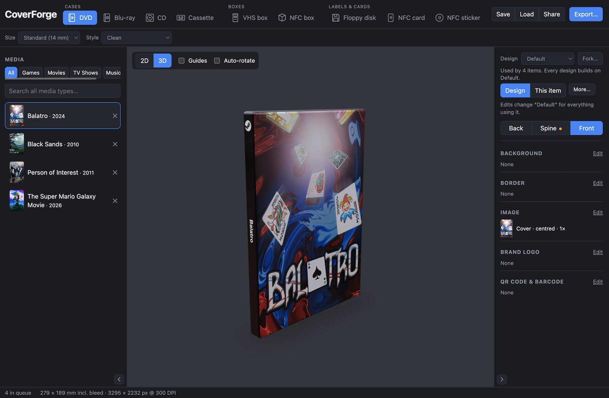

# CoverForge

Browser-based cover art generator for physical media collectors: build a queue of games, TV, movies and music (or your own artwork), pick a physical template, style it, preview it in 3D and export print-ready sheets.



## Features

- **Media sources:** Video games (Steam), TV (TVMaze), music (MusicBrainz + Cover Art Archive), movies (TMDB or OMDb) and **custom** entries with your own images. Each item gets a list of images you can assign to any panel (cover, spine, back).
- **Templates:** Blu-ray, DVD, CD and cassette cases; VHS box; NFC box (slim card box, small box, or a spineless card wallet with a slip cover); 3.5" floppy label; NFC card (front only, or front + back) and round NFC stickers (25, 30 or 35 mm). Every case also has a **Type**: *Insert* (the printed cover or label, as above), *Slipcover* (a card sleeve round the case, open at both ends, with front, back, two spines and a glue tab) or *Box* (a tuck-end box that holds the case, card or disk, with room to spare). The Type buttons sit under the case; one that a case doesn't have (a sticker has neither a slipcover nor a box, a VHS box has no insert) is disabled. Changing Type keeps the design and every edit: layers on panels the new Type doesn't have are kept, just not drawn, and come back when you switch back. The second spine copies the first until you edit it. Templates are one-click tabs with an icon each. Each has its real panel layout, bleed, and fold and cut lines, and every item in the queue follows the chosen template. Boxes have glue/tape tabs, the lid and bottom each have a tuck flap that slots in, so the ends close without glue, and dust flaps on the sides close the corners. The cassette's Back design is a flap that wraps round the spine onto the back of the case, as a partial back image.
- **Editor:** each panel is a stack of **layers** you can add to, remove, reorder and hide: pictures (the item's own, from a file or web address, or a brand logo), text boxes (any Google font, with weight, letter spacing, line height, an outline and a shadow), rectangles and ellipses (solid or gradient fills), custom graphics (SVG you write, with `{title}`-style variables filled in per item), and QR codes and EAN-13 / UPC-A / Code 128 barcodes. *Add layer* offers the main types (Text, Image, Shape, QR code or barcode, Custom graphic); what kind of picture, shape or code it is, and where it comes from, is chosen in the layer's settings. Every layer is placed the way design tools do it: pick the point of the layer to place by, then type where that point goes and how big the layer is, in percent of the panel (or let one length follow the picture's shape, or stretch between two edges). An "All panels" tab holds layers that cross the spine. On the 2D view, click a layer to select it, drag it to move it and use its handles to resize it; edges snap to the panel's edges, middle and safe margin and to other layers (hold Alt to switch snapping off, Shift to resize a picture freely), the arrow keys nudge, Delete removes and Ctrl/⌘+D duplicates. A cropped picture has a **focus point**, so its subject stays framed when you change the case. The case's own layers (panel colour, image, border, logo, code, spine text) are changed the same way; ones that start blank aren't listed until something fills them in. A dot beside a layer means the design or item changes it, and *Back to the default* undoes that. **Undo and redo** (Ctrl/⌘+Z) cover everything you make. Glue tabs, tuck flaps and dust flaps can't be designed (they fold away); the 2D view shades them as "Folds away".
- **Designs:** styling lives in **designs**. The built-in *Default* design applies to every item, and *+ New Design* in the design list makes a named design that starts as a copy of the current one and only stores what you change; the selected item uses it. *Applies to* chooses where edits go: *All media* edits the design, so everything using it follows, and *This media* edits just that item on top of its design. Designs only store what they change from the case's default layers, so they work on every template. The code for **presets** (Poster, Screenshot grid back, Retro arcade, Minimal, Gradient sleeve, Blank), saving an item's changes as a design, and exporting and importing a design as a `.coverforge-design.json` file with its images is in place, but the design bar has no buttons for them yet.
- **Branded:** each side has a "Branded" folder of **ordinary layers** with that template's official banner and spine cap: the platform's trade dress on game cases (PS4, Switch, Xbox…), or the format's mark (Blu-ray, DVD, VHS, CD, cassette, NFC) on the others. It sits above the case's pictures, logos and codes (only the spine title goes over it), and the cover picture starts beside a band or strip along an edge so the dress doesn't cut it off. Nothing is locked: recolour the band, move or resize a mark, change its text or delete a piece like any other layer, and *Put back* forgets the changes. Each folder's eye shows or hides that side only, and your changes are kept while it is off.
- **3D preview:** rotate and zoom a model of the case, box, card or disk with your artwork mapped on.
- **Export:** 300 DPI PNG/JPEG, PDF or SVG at exact millimetres with vector cut/fold guides, multi-up sheets on A4/Letter, die-cut **Avery** label sheets, and a "Download all" ZIP with each item's flat render and the print sheets (use *Save* if you also want the original source images).
- **Layout:** both side panels can be drag-resized from their inner edge (double-click it to reset) or collapsed to a slim rail; sizes are remembered per browser.
- **Session:** your queue and settings are saved in the browser and restored on return (`localStorage`, as a versioned JSON document).
- **Save, load and share:** *Save* writes the whole configuration to a `.coverforge.json` file (a native "Save as" dialog in Chrome and Edge, a normal download elsewhere) (uploaded images are embedded, so it works on another machine) and *Load* opens one. *Share* copies a link that reopens the same configuration; when it's only Steam games with default styling it's a readable link like the one below, otherwise a packed `?c=` link. Uploaded images can't travel in a link, so those slots come back empty; use *Save* for them. Links can also be written by hand — see [Deep linking](#deep-linking) below.

## Deep linking

CoverForge reads a handful of plain query params on load, so another site can link straight into a specific template and game instead of the empty app. For example, to open the generator with **Cyberpunk 2077** from Steam pre-loaded onto an **NFC card**:

```
https://kmturley.github.io/cover-forge?template=nfc-card&app=1091500
```

The params are read once on load and then stripped from the address bar, so they don't fight with later edits or reloads.

| Param | Values | Description |
| --- | --- | --- |
| `app` | one or more Steam app ids, comma-separated | Adds each game to the queue by its [Steam app id](https://store.steampowered.com/) (found in a store URL, e.g. `.../app/1091500/Cyberpunk_2077/`) and selects the last one. `appid` also works and may be repeated instead of comma-separating. |
| `template` | a template id, e.g. `dvd-std-14`, `bluray-us-11`, `game-case-ps4`, `cd-jewel` | The case the link's games open with (and the one for an empty queue). Older links that name a kind (`template=dvd`) plus a `variant` still work. |
| `banner` | `0` | Read from older links only: `0` hides the Branded folders (older links' `style=clean` and `retro` mean `0`). New links don't carry it. |
| `view` | `2d`, `3d` | Which preview mode opens. |

Not every combination produces a readable link like the one above — this only covers plain, hand-writable params. Anything involving custom uploaded images, per-item edits or multiple designs is represented by the packed `?c=…` format that *Share* generates, which isn't meant to be hand-written.

## Develop

```sh
npm install
npm run dev          # local dev server (Steam search works out of the box via a Vite proxy)
npm run type-check
npm run lint
npm test             # Vitest unit tests and the pixel-regression renders
npm run golden:update   # re-capture the golden renders after a deliberate drawing change
npm run build
npm run gen:brands   # regenerate src/brands/brands.generated.ts from Simple Icons
npm run measure:covers  # measure scans/*/*.jpg, write scans-report.md — see below
```

### Cover scan measurement (research tool)

`scripts/measure-covers.ts` is a research tool, not part of the app: point it at a folder of
real 300 DPI print files (grouped into one subfolder per case/platform, e.g. `scans/ps4/`,
`scans/ps5/`) and it measures each wrap's overall size, spine width and front header band
height/colour, then aggregates each folder to a median. It's used to cross-check the sizes and
branding percentages already recorded in `branding-spec.md` and `case-research.md` against real
files, not to replace that research.

```sh
npm run measure:covers                              # scans ./scans, writes scans-report.md
npx tsx scripts/measure-covers.ts scans --out report.md # explicit source and output
```

Source defaults to `./scans` and `--out` defaults to `scans-report.md` when omitted. Any scan
whose embedded DPI isn't exactly 300 is rejected outright and left out of the report (noted on
stderr) rather than measured at an unreliable size. `scans/` is gitignored — cover art is
copyrighted, so test images stay local and aren't committed.

## Deploy (GitHub Pages)

Pull requests run `.github/workflows/ci.yml` (type-check, lint, tests and a build). `.github/workflows/deploy.yml` type-checks, lints, tests and builds on every push to `main`, then publishes `dist/` to GitHub Pages. One-time setup:

1. **Settings → Pages → Source: GitHub Actions.**
2. *(Optional)* **Settings → Secrets and variables → Actions → Variables:**
   - `VITE_STEAM_PROXY_URL`: the CORS relay for Steam search. Defaults to the public `https://corx.venipa.workers.dev`, a third-party Worker that works today but comes with no guarantees and sees your users' search terms. A URL ending in `/` is used as a cors-anywhere-style prefix instead (`<prefix><target-url>`). Steam's API needs no key at all, so this variable is a plain CORS pass-through — nothing secret sits behind it.
   - `VITE_TMDB_API_KEY`: a free TMDB "API Read Access Token", baked into the build so every visitor gets TMDB's richer art (separate poster, backdrop and logo) with nothing to set up on their end. Get one at [themoviedb.org/settings/api](https://www.themoviedb.org/settings/api).
   - `VITE_OMDB_API_KEY`: the same idea for [OMDb](https://www.omdbapi.com/apikey.aspx), used only when no TMDB token is configured (or a visitor has switched to their own OMDb key). One poster only, no separate backdrop or logo.
   - `VITE_TMDB_PROXY_URL`: only needed if you'd rather hide your TMDB token behind a server than ship it in the client bundle — see below.

The build uses relative asset paths (`base: './'`), so it works under `https://<user>.github.io/<repo>/`.

## How it works

- **Rendering:** `src/engine/CanvasRenderer.ts` exposes a pure `renderCover()` used by the editor, the 3D texture and every export. It draws an item's resolved **layers** (`src/engine/layers/draw.ts`).
- **Layers:** `src/engine/layers/` holds the model. A case starts with default layers (`defaults.ts`, ids like `front.image`, frozen and snapshot-tested because saved designs refer to them). A design, and an item's own changes, are **diffs** over them (`diff.ts`, `diffEdit.ts`: patches, added, hidden and reordered layers), resolved in order by `resolve.ts`: default layers → Default design → the item's design → the item. Placement is anchor-based (`placement.ts`); `sanitize.ts` validates everything read from saves, links and design files; `branded.ts` turns each template's trade dress into ordinary layers; `presets.ts` holds the built-in designs. The older per-panel settings (`PanelSettings`, spine settings) are still stored beside the diffs and mapped onto layers by `fromSettings.ts`, so old saves load unchanged.
- **Fonts and images:** `src/fonts/` loads any Google font on demand through [Fontsource](https://fontsource.org) (no list to maintain, nothing bundled). Picture layers refer to **assets** (`src/storage/assets.ts`): a web address, or a file's name, size and hash so a moved or shared design can find it again.
- **Templates:** `src/templates/` builds each dieline from panel rectangles; bleed and fold/cut lines are derived from which panels touch (`geometry.ts`), so horizontal wraps, vertical strips, separate pieces and box nets all work.
- **3D:** `src/three/` builds a rounded box or card/disk from each template's preview spec and maps the flat artwork onto it.
- **Sheets:** `src/export/imposition.ts` packs items on plain paper; `src/export/sheets.ts` places them on die-cut Avery sheets, centred on each label and cropped to it.
- **Codes:** QR codes are drawn from the module matrix and barcodes from standard encoders, so they scan (verified by decoding rendered output). A code that doesn't fit inside its panel's safe area is omitted. The QR default is `steam://run/{appId}`, which launches the game in the Steam app. Barcodes print real EAN-13/UPC-A digits if you type them (the check digit is verified); without digits a number from the reserved in-store range is generated, because there is no free title-to-barcode lookup.
- **Dimensions:** Blu-ray panels are 128 × 149 mm (spine 11 mm), DVD 129.5 × 183 mm (spine 14 mm, or 7 mm slim). Sizes no longer offered (Blu-ray Elite 12.5 mm and EU 14 mm, the 9 mm DVD slim) still open at their original size in older saves and links, VHS box 105 × 190 × 25 mm (portrait, spine on the long side), cassette J-card 65.1 + 12.7 + 25.4 × 101.6 mm, CD booklet 120 × 120 mm with a 137 mm tray card. These follow the figures published by cover-template suppliers ([printdvdcover.com](https://www.printdvdcover.com/blu-ray-elite-case-cover-layout.php), [CoverStitch](https://coverstitch.io/dimensions.html), a duplicator's [Blu-ray trapsheet spec](https://www.duplication.com/printspecs/blu-ray.php)); suppliers differ by 1–2 mm, so measure your own insert if it has to be exact. Bleed is 3 mm for cases and 1 mm for labels and cards. Slipcovers and boxes are built from the case's outside size (`src/templates/pieces.ts`, sourced in [case-research.md](case-research.md)) plus 1.5 mm (slipcover) or 2 mm (box) of room on each dimension. **Those two allowances are assumptions, not published figures**, and a cassette case's outside size (not researched) is worked out from its insert; measure your own case if it has to be exact. A slipcover or box can be bigger than the paper, and the print-sheet preview then says it needs a larger printer or paper size.
- **3D:** cards, stickers and disks are extruded from their real outline (CR80 corners are 3.18 mm; a sticker is a circle; a floppy has the cut corner, shutter with window and drive hub), with the artwork following that outline.
- **Uploads:** custom images are stored untouched in the browser's IndexedDB (a browser can't keep a path to your file), so nothing is scaled. They live in that browser only and aren't part of a saved session's JSON.
- **Links:** `src/context/share.ts` packs the session JSON with deflate and URL-safe base64 into `?c=…` (about 1.4 KB for one game). The address bar is cleaned after it is read, so later edits and reloads aren't overridden. Over about 6,000 characters the app suggests *Save* instead.
- **Sources:** `src/api/providers/` gives every catalogue the same `search()` / `createItem()` shape. Searches only offer results that have cover art.
- **Tests:** besides unit tests, `src/engine/regression/` renders 130 scenes (every case, the Branded dress and each kind of layer) and compares them with golden PNGs in `__golden__/`, so a drawing change shows up as a changed pixel. They are compared exactly on macOS, where they were captured, and loosely elsewhere (scenes with big text boxes more loosely, since Linux has different fonts). After a deliberate change, run `npm run golden:update` and review the changed images.

### Sheet geometry: what is verified

Avery **5371** (business cards) and **5395** (name badges) use published sizes and margins that add up exactly to the page. **5196** (3.5" diskette labels) has published size, count and margins, but its vertical spacing is assumed, and the app says so. Print one page on plain paper and hold it against a real sheet before using labels.

### Trademarks and third-party data

Store and console marks come from [Simple Icons](https://simpleicons.org) (CC0 artwork; the brands remain trademarks of their owners), baked into `src/brands/brands.generated.ts`. Xbox and Nintendo marks aren't available from that source and aren't included. Artwork comes from each provider's public API or CDN and belongs to its owners. See [THIRD_PARTY_NOTICES.md](THIRD_PARTY_NOTICES.md).

## Not built yet

- Non-Steam game catalogues.
- A slipcover's open ends in the 3D view (they show as plain card), and a card-thickness allowance for slipcovers and boxes.
- Automatic focal-point detection, and dragging inside a cropped picture to set its focus.
- Highlighting the selected layer in the 3D view, and drag-to-reorder in the layer list (it has up and down buttons).
- Buttons for presets, saving an item's changes as a design, design file export and import, and renaming, resetting or deleting a design.
- Plugins that run your own code.
